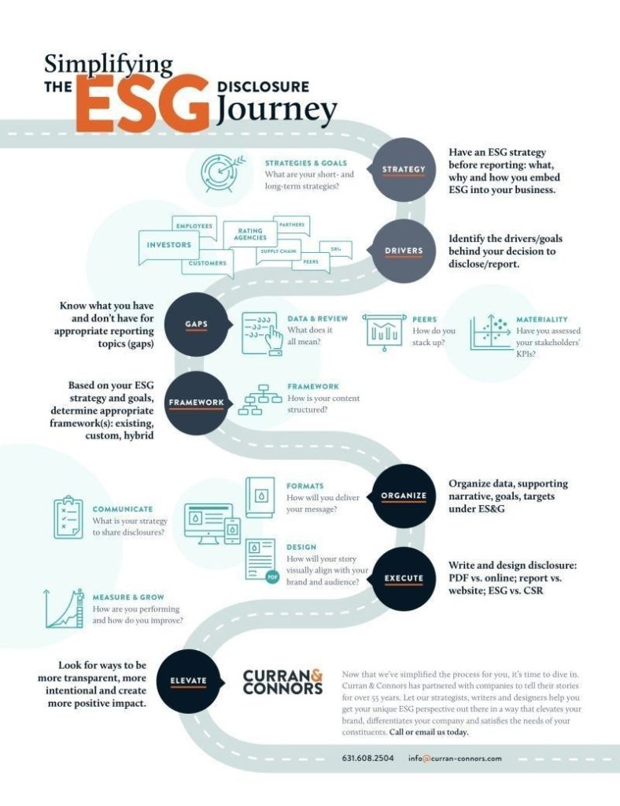

El término **ESG** (Ambiental, Social y de Gobernanza) ha pasado de ser una sigla de nicho a un pilar fundamental en el mundo empresarial. Las empresas que logran comunicar de forma efectiva sus compromisos y progresos en sostenibilidad no solo cumplen con una expectativa del mercado, sino que también construyen una reputación sólida, atraen a inversores conscientes y se diferencian de la competencia.

Sin embargo, el camino hacia una divulgación ESG transparente y estratégica puede parecer complejo. Afortunadamente, existe un proceso estructurado que puede guiar a las organizaciones en este viaje. Inspirado en el **modelo de Curran & Connors**, este "mapa" de ocho pasos está diseñado para simplificar el proceso y convertir la divulgación de sostenibilidad en una herramienta poderosa para el crecimiento.

* * *

## 1\. Estrategia: El Punto de Partida

Antes de redactar el primer informe, es crucial definir la **estrategia ESG**. Pregúntese: ¿Cuáles son nuestros objetivos a corto y largo plazo en materia de sostenibilidad? ¿Cómo se alinea el ESG con nuestra misión principal? Este paso asegura que la divulgación no sea un simple ejercicio de cumplimiento, sino una comunicación intencional de los valores de la empresa.

## 2\. Identificar los Impulsores

¿Por qué su empresa está priorizando la divulgación ESG? Las razones pueden ser variadas: presiones de inversores, demandas de los clientes, regulaciones gubernamentales o simplemente un compromiso genuino con la responsabilidad social corporativa (RSE). Identificar estos **impulsores** le dará un propósito claro y definirá el tono de su mensaje.

## 3\. Analizar las Brechas

Es imposible mejorar lo que no se mide. En esta fase, es momento de un autoanálisis honesto. Evalúe qué **datos de sostenibilidad** tiene y cuáles le faltan. Compare su rendimiento con el de sus competidores (**pares**) y, lo más importante, identifique los temas materiales o **KPIs** que realmente importan a sus stakeholders (empleados, inversores, clientes).

## 4\. Elegir el Marco de Referencia

Con la estrategia y el análisis de brechas en mano, el siguiente paso es elegir un **marco de referencia** para su informe. Puede optar por un estándar global como GRI, SASB o TCFD, crear un marco personalizado o combinar varios. La clave es seleccionar una estructura que ayude a contar su historia de sostenibilidad de manera coherente y creíble.

## 5\. Organizar la Narrativa

La divulgación ESG no es solo una hoja de cálculo con datos; es una oportunidad para contar una historia. En esta etapa, defina los **formatos** de entrega (PDF, sitio web interactivo) y el **diseño** visual. Asegúrese de que la narrativa y la identidad de marca se unan para crear un mensaje poderoso y atractivo.

## 6\. Ejecutar: El Proceso de Creación

Ahora es el momento de redactar y diseñar. La **ejecución** implica transformar los datos y la estrategia en un informe tangible. Considere las diferentes audiencias y formatos. Un informe detallado puede ser ideal para inversores, mientras que una sección en el sitio web puede ser más accesible para el público general.

## 7\. Comunicar Estratégicamente

No basta con publicar un informe. Es fundamental tener una **estrategia de comunicación** sólida para asegurarse de que su mensaje llegue a la audiencia correcta. Utilice todos sus canales, desde redes sociales hasta comunicados de prensa, para maximizar el alcance de su divulgación.

## 8\. Medir, Crecer y Elevar

La divulgación ESG no es un evento único, sino un ciclo de mejora continua. Después de publicar, **mida** el impacto y el alcance de su informe. Busque comentarios de sus stakeholders e identifique áreas para **crecer**. El objetivo final es **elevar** el nivel de transparencia, intencionalidad e impacto positivo en su próxima divulgación.

## En conclusión

Este proceso estructurado convierte lo que podría ser una tarea compleja en una hoja de ruta estratégica para el liderazgo en sostenibilidad. Seguir estos pasos no solo facilita la divulgación, sino que también posiciona a la empresa como un actor clave en la construcción de un futuro más sostenible. ¿Está su empresa lista para emprender este viaje?

* * *

<figure>

<figcaption>

Infografía de Curran & Connors: "Simplificando el viaje de divulgación ESG"

</figcaption>

</figure>
