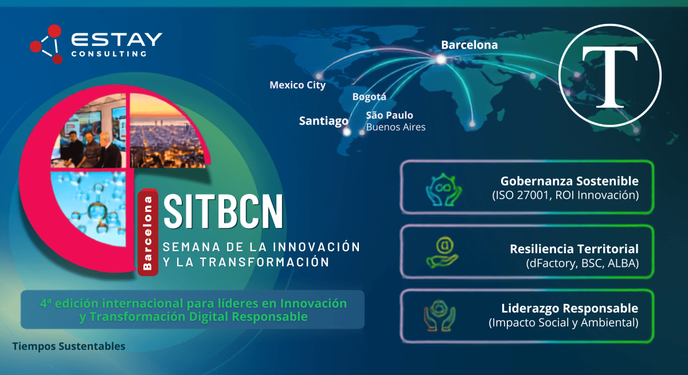
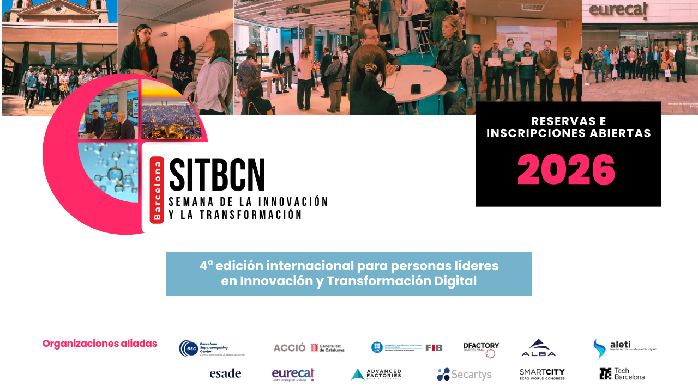

La Semana de la Innovación y la Transformación en Barcelona conecta a líderes latinoamericanos con modelos avanzados de gobernanza y tecnología estratégica. El programa facilita el intercambio de conocimientos sobre sostenibilidad y resiliencia urbana mediante la observación directa de infraestructuras críticas dentro de uno de los ecosistemas más activos de Europa.

La edición final de 2026 consolidará un ciclo de formación enfocado en la competitividad responsable y la eficiencia sistémica. A través de metodologías de consultoría y visitas técnicas, los directivos integran marcos de innovación para optimizar recursos, mitigar riesgos y responder a las exigencias globales de descarbonización.

<figure>

<figcaption>

SITBCN 2026: Semana de la Innovación y la Transformación en Barcelona, enfocada en gobernanza, resiliencia y liderazgo responsable.

</figcaption>

</figure>

Barcelona se ha consolidado como un laboratorio vivo de innovación urbana en Europa, convirtiéndose en un ecosistema vital donde la tecnología actúa como medio para una transformación productiva con propósito. Para la alta dirección en Chile y Latinoamérica, la **Semana de la Innovación y la Transformación (SITBCN)** no es solo otro evento académico; es un nexo crítico para captar modelos de gobernanza que garantizan la competitividad en una economía global que busca de forma responsable la descarbonización y el uso eficiente de recursos tecnológicos.

En el contexto actual, donde el éxito corporativo se mide por la resiliencia territorial, la eficiencia sistémica y la construcción de nuevos futuros, SITBCN ofrece una inmersión estratégica diseñada para transformar la toma de decisiones a nivel ejecutivo. Este evento requiere nuevas formas de diseñar y prospectar estrategias que sean efectivas y adaptadas a los desafíos contemporáneos.

Es fundamental que los líderes regionales comprendan que no se debe confundir SITBCN con eventos de nicho técnico como el SAP Inside Track. Mientras que el SAP Inside Track se centra en la implementación de herramientas específicas, SITBCN es una experiencia de gobernanza y liderazgo para el cambio, que dialoga con líderes y lideresas que están construyendo estrategias innovadoras para el futuro. Bajo la premisa de que "la innovación no se estudia, se vive", el programa emplea la "observación territorial" para que los ejecutivos chilenos y latinoamericanos experimenten cómo una infraestructura de _smart city_ consolidada se traduce en retornos operativos y en la creación de nuevos activos.

Esta exposición directa redefine el juicio directivo, permitiendo una transferencia contextualizada de conocimiento y tecnología que supera los formatos tradicionales. Desde su inicio en 2023, SITBCN ha continuado su trayectoria de excelencia, alcanzando su punto de máxima madurez estratégica. Este evento no está diseñado para quienes buscan copiar modelos y conceptos; es para aquellos que desean crear diseños estratégicos innovadores que ofrezcan competitividad diferenciadora en el mercado.

### Beneficios de participar en SITBCN

- **Innovación Continua**: Inmersión en experiencias prácticas de innovación urbana.

- **Networking de Alto Nivel**: Conexiones con líderes de pensamiento y expertos en transformación.

- **Aprendizaje Contextualizado**: Acceso a casos de estudio de _smart cities_ que fomentan el aprendizaje activo.

Participar en la Semana de la Innovación y la Transformación en Barcelona es clave para posicionarse como líder innovador en el ámbito empresarial y contribuir a una transformación responsable y sostenible en Latinoamérica.

* * *

## **Memoria de Transformación: El Camino Hacia la Cuarta Edición (2023-2025)**

La evolución de SITBCN refleja el paso de la digitalización reactiva hacia una sostenibilidad sistémica. Lo que comenzó como un análisis de agilidad organizacional ha madurado hasta convertirse en una hoja de ruta para la competitividad responsable en mercados internacionales.

| Edición / Año | Hito Central | Colaboradores Clave | Enfoque Sustentable |
| --- | --- | --- | --- |
| **2023** | Colaboración que crea oportunidades  | Eurecat, Sincrotrón Alba | Resiliencia urbana y gobernanza ágil pública-privada.Vinculaciones públicas-privas-académicas-sociales resilientes y propositivas. |
| **2024** | Ecosistema en red: crecer conectando   | ACCIÓ / Packaging & Digital Clusters | Asociatividad, economía circular y eficiencia energética.Ecosistemas siempre abiertos, circulares, eficientes, responsables. |
| **2025** | Liderazgo para el cambio complejo | Hospital de Sant Pau / Smart City Expo World Congress  | Sostenibilidad social, salud comunitaria e innovación abierta.La mirada urbana, tecnológica y estratégica. |

El modelo de clústeres observado en la segunda edición es una lección fundamental de asociatividad para la región. Actores como el _Packaging Cluster_ demuestran que la sostenibilidad no es un esfuerzo corporativo individual, sino una ambición colectiva: el uso responsable de la digitalización, las tecnologías y la IA permiten optimizar materias primas y reducir residuos de forma coordinada, un _blueprint_ esencial para la industria exportadora del Cono Sur. Esta experiencia es una de las bases de la memoria institucional, y prepara el terreno para la cumbre más ambiciosa del programa: SITBCN 2026.

## **SITBCN 2026: La Cumbre Definitiva y el Cierre de un Ciclo**

La cuarta y última edición de SITBCN, programada para noviembre de 2026, marca el fin de un ciclo histórico de transferencia de conocimiento, de consolidar una comunidad de profesionales que lideran con responsabilidad, que no esperan cómo actuar, crean acciones y oportunidades. Para los líderes que buscan consolidar redes de alto nivel, existe un sentido de urgencia estratégica: esta es la oportunidad definitiva para acceder a una curaduría personalizada de conexiones europeas antes de la evolución del formato.

El valor diferencial de esta edición final radica en su proceso de postulación selectivo y una sesión de _pre-networking_ diseñada para alinear las visitas técnicas con los desafíos de sostenibilidad específicos de cada empresa participante. El objetivo es facilitar alianzas de valor a largo plazo que sobrevivan al evento mismo.

* * *

## **Estay Consulting: Arquitectos de la Innovación Estratégica Sostenible**

Detrás de esta sólida arquitectura metodológica se encuentra **Estay Consulting**, una firma líder con más de 80 proyectos estratégicos en 9 mercados. Bajo la dirección del Dr. Christian Estay-Niculcar, la consultora ha establecido un marco conceptual que claramente distingue la operatividad de la trascendencia.

**Christian A. Estay-Niculcar** es el CEO & Founder de **Estay Consulting**. Doctor (PhD) con más de 25 años de trayectoria global, fusiona la alta academia con la consultoría estratégica. Impulsa la transformación digital, la innovación abierta y el cambio cultural en corporaciones y gobiernos de Iberoamérica.

### Conceptos claves a considerar:

- **Innovación Sostenible:** La capacidad de mantener la continuidad del proceso innovador, asegurando la gobernanza del ROI con estrategias y personas para que la creatividad genere oportunidades sin agotarse en ineficiencias internas.

- **Innovación Sustentable:** El equilibrio ecológico, el impacto social y la resiliencia territorial alineada con los ODS.

Estay Consulting formaliza esta eficiencia mediante un enfoque de  **Innovación Estratégico Sostenible**, definido por la fórmula: **_sigma\=(S+T)/(1−E)sigma = (S + T) / (1 - E)_**.

> Aquí, **S** es el ahorro por interoperatividad (hasta un 25%), **T** es la reducción de ciclos de trabajo, y **E** es la mitigación de pérdida de datos, un factor que surge de la innovación. Este modelo, respaldado por la norma **ISO 27001**, protege la propiedad intelectual y permite reinvertir capital en tecnologías limpias y procesos de alta efectividad con mínima pérdida de recursos.

## **Los Centros del Mañana: Infraestructura para la Acción Climática**

Las visitas técnicas de SITBCN, en Barcelona permiten apreciar la infraestructura humana, científica y tecnológica que se pone al servicio de la resiliencia:

1. **dFactory / 3D Incubator:** Fabricación aditiva que elimina el descarte de manufactura tradicional y reduce la huella de carbono logística.

3. **BSC (Barcelona Supercomputing Center):** El _MareNostrum 5.0_ permite simulaciones climáticas de alta fidelidad, una herramienta crítica para que países como Chile diseñen estrategias de resiliencia hídrica frente a la sequía prolongada.

5. **Sincrotrón ALBA:** Caracterización de materiales a nivel molecular para optimizar celdas de almacenamiento de energía renovable.

7. **Barcelona Activa:** Modelo de desarrollo económico que equilibra la competitividad con el reequilibrio territorial.

Este ecosistema se gestiona mediante el **Sistema de Indicadores de Sostenibilidad Turística (SITS-OTB)**, cuya matriz de impacto es un referente para el control ambiental:

- **I01 (Distancia media):** Cálculo de emisiones indirectas (Alcance 3).

- **I02 (Ruido urbano):** Evaluación de bienestar y salud (ODS 3/11).

- **I03 (Alertas de contaminación):** Monitoreo de calidad del aire para regulación industrial.

* * *

## **Implicancias para Chile y Latinoamérica: De Importadores a Ecosistemas**

Latinoamérica enfrenta un déficit ecológico en el 75% de sus países, pero las "ventanas verdes" tecnológicas descritas por CEPAL y el BID ofrecen una oportunidad de salto cualitativo. SITBCN 2026 es el portal hacia estas ventanas. La región debe dejar de ser una importadora pasiva para convertirse en arquitecta de sus propios ecosistemas.

### Recomendaciones estratégicas:

- **Gobernanza bajo estándares ISO 27001:** Asegurar que el flujo de conocimiento sea un activo permanente y seguro.

- **Gestión proactiva del Riesgo de Alcance 3:** La digitalización de la trazabilidad es hoy una cuestión de supervivencia competitiva para exportar a mercados europeos bajo regulaciones ESG.

- **Adopción de indicadores de impacto territorial:** Integrar métricas inspiradas en el SITS-OTB para medir el valor real más allá del retorno financiero.

- **Uso responsable de la IA:** usar la IA, o la computación cuántica, o las nuevas tecnologías digitales y no digitales, requiere marcos que fortalezcan una sostenibilidad sostenible y respetuosa y Barcelona es el sitio donde los avances técnicos y sus estrategias están al servicio de nuevos futuros donde las personas tengan un futuro de un mejor vivir. 

En última instancia, como demuestran los testimonios de SITBCN, el juicio humano es insustituible. La tecnología sólo es sostenible cuando está liderada por una ética que conecta el interés empresarial con la vitalidad de la sociedad y el territorio.

* * *

Desde **Tiempos Sustentables** te invitamos a informarte y **postular directamente en [innovaweek.com](https://www.innovaweek.com/)**. No pierdas la oportunidad de ser parte de uno de los eventos de innovación más importantes del país.

* * *

* * *
