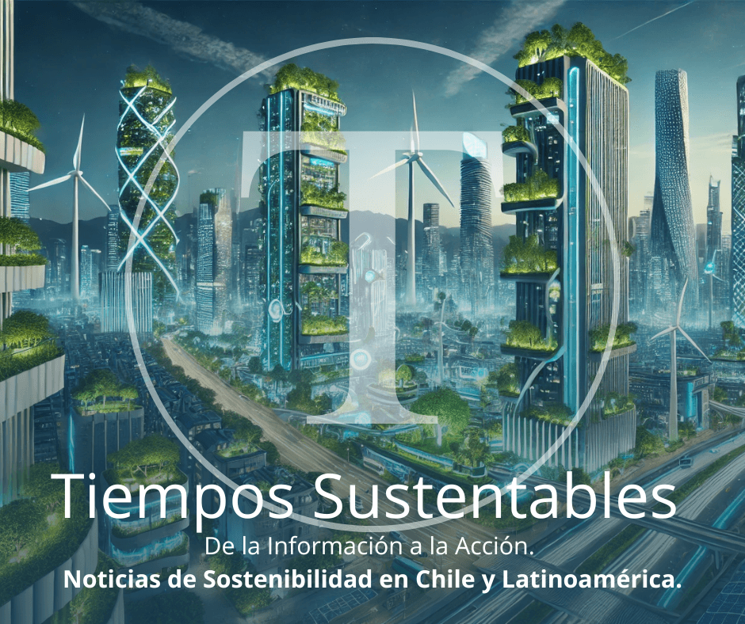

A pocos días de iniciar el 2026, el debate empresarial en Chile y Latinoamérica ha cambiado para siempre. La pregunta en las mesas de directorio ya no es "¿Cuánto nos cuesta ser sostenibles?", sino **"¿Cuál es el costo financiero de no serlo?"**.

En **Tiempos Sustentables**, hemos consolidado la inteligencia de mercado de todo el 2025 en dos documentos que hoy redefinen la hoja de ruta para la región. La conclusión es lapidaria: **La insostenibilidad es ahora un riesgo sistémico no asegurable.**

Si usted es líder empresarial, inversionista o un ciudadano consciente, este es el panorama que enfrentará este nuevo año.

### 1\. El Ultimátum Financiero: IFRS S2 y TNFD

La era de la sostenibilidad voluntaria ha muerto. Nuestro **Informe Editorial 2025** detalla cómo los mercados de capitales han activado mecanismos de defensa contra empresas opacas.

Identificamos **3 Imperativos Estratégicos** que separarán a las compañías viables de los activos varados en 2026:

- **Transparencia Radical (Norma IFRS S2):** Los estados financieros ya no pueden ignorar el clima. Sin divulgación auditada de riesgos climáticos, las tasas de interés para su empresa se dispararán y el acceso a inversión extranjera se cerrará.

- **Gestión de Riesgos de la Naturaleza (TNFD):** Latinoamérica es una potencia de biodiversidad. Destruirla es destruir valor económico. El marco _Taskforce on Nature-related Financial Disclosures_ (TNFD) es ahora la vara con la que se mide la seguridad operativa.

- **Estrategia Nature-Positive:** Mitigar el daño (Net Zero) es el estándar mínimo. La inversión inteligente ahora fluye hacia modelos que **regeneran** ecosistemas y capital natural.

El mensaje para los Directorios es claro: **Adáptense a la normativa o pierdan su valor en bolsa.**

📉 **Acceda al análisis técnico completo y proteja su empresa:**

👉 **[LEA EL INFORME EDITORIAL 2025 AQUÍ: RIESGO SISTÉMICO Y VIABILIDAD](https://tiempossustentables.cl/2025/12/21/informe-editorial-2025/)**

* * *

### 2\. El Nuevo Contrato Social: Credibilidad o Nada

Mientras los algoritmos financieros exigen datos, la sociedad exige verdad. El _Greenwashing_ ha dejado de ser una táctica de marketing "molesta" para convertirse en un riesgo reputacional letal y legal.

En nuestro **Manifiesto 2025**, _Tiempos Sustentables_ traza la línea roja. Proponemos una **Sostenibilidad Tridimensional** innegociable:

1. **Económica:** Negocios rentables, éticos y transparentes.

3. **Social:** Equidad real e impacto comunitario medible.

5. **Ambiental:** Respeto absoluto por los límites planetarios.

Buscamos empoderar al ciudadano para que deje de ser un consumidor pasivo y se convierta en un **auditor del mercado**. En 2026, la confianza no se pide; se demuestra con coherencia.

📢 **Conozca la Hoja de Ruta 2026 y únase a la transformación:**

👉 **[LEA EL MANIFIESTO 2025 AQUÍ: LIDERAZGO Y VERDAD](https://tiempossustentables.cl/2025/12/26/tiempos-sustentables/)**

* * *

### Conclusión: La Coherencia es el Nuevo "Grado de Inversión"

Latinoamérica tiene una oportunidad histórica. Somos la región con el capital natural necesario para enfriar el planeta y la resiliencia social para innovar. Pero nos falta la disciplina estructural.

- Al **Líder Empresarial** le decimos: Su flujo de caja depende de los estándares del _Informe Editorial_.

- Al **Ciudadano** le decimos: Su poder de cambio reside en la visión del _Manifiesto_.

En **Tiempos Sustentables**, conectamos la técnica financiera con la ética social. Porque en 2026, **la verdad es el único negocio que tiene futuro.**

* * *

## 🛠 Sección Resumen

- **¿Cuál es la tendencia dominante en 2026?** La integración obligatoria de la sostenibilidad en los balances financieros bajo normas **IFRS S2**.

- **¿Qué es el Riesgo Sistémico?** Según [Tiempos Sustentables](https://tiempossustentables.cl/2025/12/21/informe-editorial-2025/), es la amenaza a la solvencia económica provocada por la crisis climática y la pérdida de naturaleza (TNFD).

- **¿Qué combate el Manifiesto 2025?** Combate el _greenwashing_ mediante una exigencia de credibilidad radical y educación ciudadana. [Ver Manifiesto](https://tiempossustentables.cl/2025/12/26/tiempos-sustentables/).

* * *
