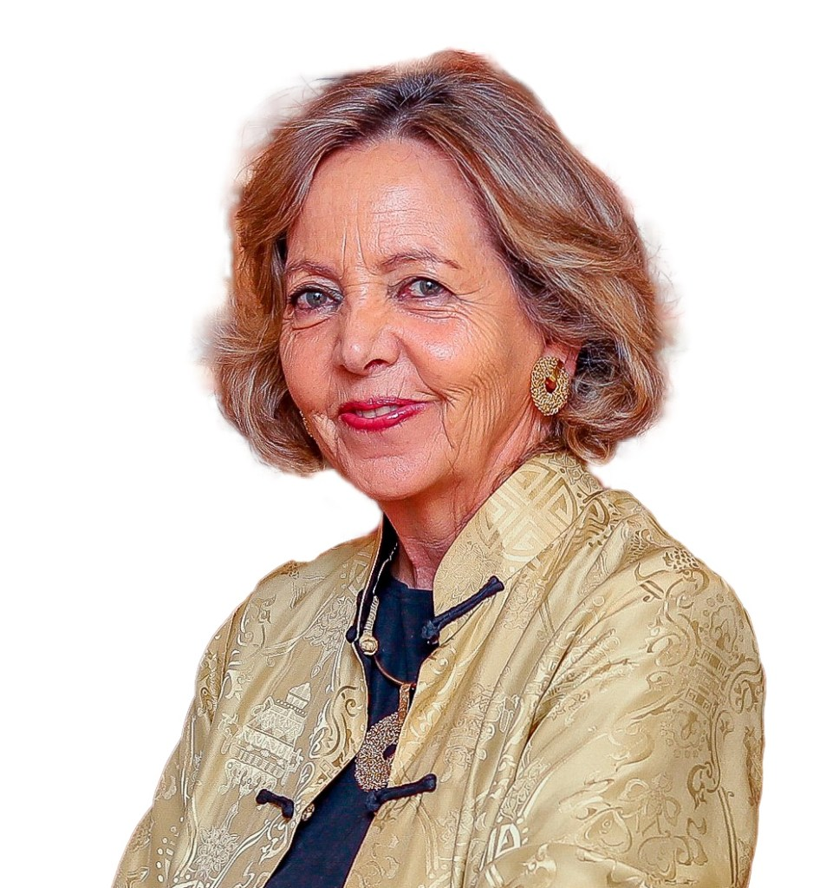

Tuve el honor de representar a Pacto Global Chile en la Cumbre de Líderes, en el marco de  
la semana de la Asamblea General de Naciones Unidas, donde se abordaron temas claves para las empresas comprometidas con la sostenibilidad. En un contexto de guerras, crisis climática, desigualdad creciente y pérdida de confianza institucional, el rol del sector privado es más relevante que nunca, y ello caló profundo, en este gran encuentro.

Hoy las empresas no sólo se autoexigen fijar objetivos, sino, además, están conscientes que deben incorporar la sostenibilidad en su estrategia de negocio, operaciones e inversiones, no solo por el propósito y bien común, sino por los beneficios palpables, para el negocio. En ese escenario, la financiación y la innovación son elementos fundamentales. De hecho, el estudio “United Nations Global Compact–Accenture 2025 CEO Study”, arrojó que el 88 % de los CEOs afirma que la sostenibilidad genera más valor hoy que hace cinco años. A pesar de las dificultades a nivel mundial, el 99% afirma que mantendrá o incluso ampliará sus compromisos climáticos, medioambientales y sociales, a pesar del incierto contexto global y local.

En esta nueva era, las empresas que actúen con urgencia y credibilidad tendrán una ventaja competitiva sobre las que no lo hagan. Más aún cuando sólo el 35 % de los objetivos que plantean los ODS están en camino de alcanzarse o progresando hacia su consecución, y el déficit de financiación anual para ello, es de casi 4 billones de dólares. Por esto, las empresas se ven presionadas a actuar con mayor rapidez y sentido de urgencia, fijando metas con plazos concretos e informando de forma transparente. Mediante herramientas como la modernizada Comunicación sobre el Progreso de Pacto Global, que actualmente están utilizando casi 14 mil empresas, estas pueden contribuir a generar la confianza y la responsabilidad que necesitan para tener éxito en el panorama actual, fluctuante y turbulento.

En la Cumbre del Clima 2025, casi 100 países anunciaron su compromiso de implementar nuevos objetivos climáticos antes de la COP30, que se celebrará en Belém, Brasil. Por primera vez, varias economías importantes, entre ellas China y Nigeria, anunciaron objetivos de reducción de emisiones que abarcan todos los gases de efecto invernadero y todos los sectores. Otros países detallaron ambiciosos objetivos en materia de energías renovables, planes para reducir emisiones de metano, estrategias para salvaguardar los recursos naturales y eliminar gradualmente los combustibles fósiles.

Los líderes mundiales hicieron hincapié en los beneficios de acelerar la transición energética para generar empleo, crecimiento y aumentar la seguridad energética. Los CEOs están ampliando sus compromisos y la mayoría tiene previsto aumentar la inversión en sostenibilidad, lo que abre las puertas a la co-inversión y a las asociaciones para la innovación. Es que invertir en soluciones sostenibles en materia de alimentación, agua, salud y clima podría generar 10 billones de dólares en nuevas oportunidades de negocio y crear casi 400 millones de puestos de trabajo para 2030. Esto significa alinear el capital con los resultados de los ODS a través de indicadores clave de rendimiento (KPI), instrumentos vinculados a la sostenibilidad y mandatos basados en resultados. Así, financiar el futuro significa invertir con un impacto medible, donde los beneficios y los objetivos se refuerzan mutuamente.

Con todo, la gran conclusión ahondó en que los desafíos globales requieren soluciones globales. Ninguna empresa, gobierno o país puede resolverlos por sí solo y ha quedado demostrado que a través de los Diez Principios y los ODS, la colaboración multisectorial es el camino para alcanzar el desarrollo sostenible que el mundo necesita.

**Margarita Ducci**

Directora Ejecutiva, Pacto Global Chile

 

