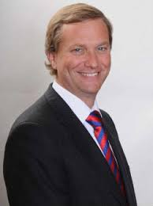
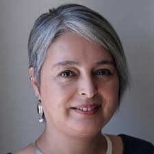
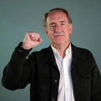
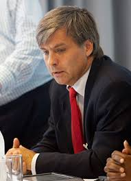
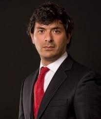
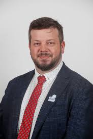
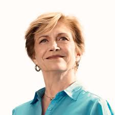
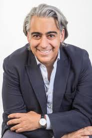

El pulso político de Chile late al ritmo de la seguridad, el empleo y la salud. Así lo demostró el reciente debate presidencial, un escenario donde las visiones de **José Antonio Kast, Jeannette Jara, Evelyn Matthei, Johannes Kaiser, Eduardo Artés, Marco Enríquez-Ominami, Franco Parisi** y **Harold Mayne-Nicholls** se enfrentaron con urgencia, pero sin una hoja de ruta clara para el desafío más grande de nuestro tiempo: la **sostenibilidad**.

En _Tiempos Sustentables_, hemos analizado las propuestas de cada candidato, no desde la ideología, sino desde su impacto en el futuro a largo plazo de nuestro país. Aunque la palabra “sostenibilidad” rara vez se mencionó, las ideas de los aspirantes dibujan tres caminos distintos: el de la economía, el de la sociedad y, un sendero casi inexistente, el del medioambiente.

* * *

### **Un Viaje por las Propuestas** sobre **Sostenibilidad**:

Para entender la visión de cada candidato, desglosamos sus ideas en las tres dimensiones clave de la sostenibilidad.

#### **1\. Sostenibilidad Económica: Crecer para Sanar las Heridas**

Aquí, las propuestas se dividieron en dos grandes grupos:

- **Los Pro-Mercado y la Eficiencia Fiscal:** Candidatos como **José Antonio Kast** y **Johannes Kaiser** apuestan por la reducción del gasto público y la reforma tributaria para impulsar la productividad. La idea es simple: un Estado más pequeño y eficiente para que el sector privado pueda crecer y generar empleo. **Evelyn Matthei** y **Harold Mayne-Nicholls** también se alinean en este eje, buscando atraer inversiones y generar valor agregado a nuestros recursos naturales. **Franco Parisi**, por su parte, propone reducir el gasto para bajar la tasa de interés y reactivar la economía, con un enfoque en la infraestructura.

- **Los Propulsores del Rol Estatal y la Justicia Distributiva:** Por el otro lado, **Jeannette Jara** y **Eduardo Artés** defienden un Estado protagonista. Jara busca reducir las desigualdades con un "ingreso vital" y un aumento del sueldo mínimo, mientras que Artés va más allá, proponiendo la reindustrialización y el control estatal de recursos estratégicos como el litio y el cobre. **Marco Enríquez-Ominami** se une a este grupo, abogando por un Estado protector que apoye a las pymes y fomente la inversión pública.

#### **2\. Sostenibilidad Social: El Debate sobre Orden y Bienestar**

La seguridad fue el tema central, con propuestas que van desde la "mano dura" hasta la prevención comunitaria.

- **Orden a Toda Costa:** **José Antonio Kast** y **Franco Parisi** proponen medidas radicales, como el despliegue militar en las calles o la "flexibilización" de la tenencia de armas, junto con políticas de inmigración estrictas que incluyen zanjas o la minería del norte. **Johannes Kaiser** se suma con una postura de expulsión masiva de inmigrantes ilegales y una reforma institucional profunda.

- **Seguridad y Bienestar con Prevención:** **Jeannette Jara** y **Harold Mayne-Nicholls** se inclinan por un enfoque más tecnológico y preventivo, que combine el fortalecimiento de las fronteras con la regularización de inmigrantes, considerando la seguridad una responsabilidad del Estado. **Evelyn Matthei** propone una mezcla de inteligencia financiera y control fronterizo para combatir el crimen organizado. **Eduardo Artés** cree que la seguridad debe ser coordinada por organizaciones populares. Todos, de una u otra forma, abordan la necesidad de reducir las listas de espera en salud y fortalecer la atención primaria.

#### **3\. Sostenibilidad Medioambiental: El Gran Ausente**

Este es, sin duda, el pilar más débil de la discusión. La mayoría de los candidatos no presentaron propuestas concretas o, en el mejor de los casos, la mencionaron solo como un motor de crecimiento económico.

La excepción fue **Marco Enríquez-Ominami**, el único que explicitó el cambio climático como un desafío central. Sus propuestas de **polos de acero verde e hidrógeno verde** lo posicionan como el candidato con la visión más alineada a un desarrollo industrial sostenible y la descarbonización. La mención de las energías renovables por parte de **Evelyn Matthei** también insinúa un potencial, aunque no profundiza en políticas ambientales. El resto, simplemente lo obvia.

* * *

### Cuadro Comparativo por Candidato:

| Candidato | Ámbito Económico | Ámbito Social | Ámbito Medioambiental |
| --- | --- | --- | --- |
| **José Antonio Kast**    (Partido Republicano y Partido Social Cristiano)    | \- **Empleo:** Propone facilitar regulaciones, implementar una reforma tributaria proempleo (créditos y rebajas para empresas que contraten) y **reducir el gasto estatal** eliminando 10.000 "operadores políticos".      \- **Gasto Público:** Aboga por recortes en "operadores políticos" y combatir "licencias falsas".      \- **Pensiones:** Defiende la **PGU (Pensión Garantizada Universal)** y busca proteger los fondos de los trabajadores, impidiendo su uso para "operadores políticos" o un gobierno ineficiente. | \- **Seguridad:** Enfatiza la **aplicación de "mano dura"** contra la delincuencia y considera la **inmigración ilegal un delito**. Propone el **cierre de fronteras** con medidas como zanjas y combatir el transporte, alojamiento y comercio ilegal, además de establecer cárceles especiales para extranjeros delincuentes que cumplirán su pena en Chile antes de ser expulsados. Apoya la flexibilización de la **tenencia responsable de armas para civiles** y el uso de armas no letales por inspectores municipales.      \- **Salud:** Plantea una emergencia sanitaria y propone potenciar la atención primaria (CESFAM), implementar "médico a su casa" y fortalecer la salud mental (COSAM).      \- **Educación:** Busca recuperar los liceos emblemáticos. | No presenta propuestas medioambientales específicas. Su mención de un "corredor ecológico para unas arañitas" con tono crítico sugiere una baja prioridad a ciertas medidas de protección ambiental. |
| **Janet Jara**    (Pacto Unidad por Chile)    | \- **Empleo/Salario:** Propone **aumentar el sueldo mínimo por encima del IPC** y establecer un **ingreso vital de $750.000**, apoyado con subsidios y ayuda a las pymes. Destaca la creación de más de 500.000 empleos durante su gestión como ministra.      \- **Crecimiento:** Reconoce la necesidad de **impulsar el crecimiento** y fortalecer el empleo ante desafíos estructurales.      \- **Pensiones:** Expresa orgullo por haber liderado y apoya la reforma previsional actual, destacando las mejoras en la PGU y las pensiones para mujeres y cotizantes. | \- **Seguridad:** Promueve la **incorporación de nuevas tecnologías** y la **prevención comunitaria**. Enfrenta el narcotráfico y el crimen organizado mediante el **levantamiento del secreto bancario**. Propone el **empadronamiento de inmigrantes** para conocer su identidad y antecedentes, y luego regularizarlos, además de fortalecer las fronteras con tecnología (Cifrón), rechazando zanjas o minas antipersonales. Apoya el uso de armas no letales por inspectores municipales y propone una **agencia nacional de control de armas**.      \- **Salud:** Aboga por la **formación de más especialistas**, su proyecto de **mamografía sin dolor** y el fortalecimiento de la atención primaria.      \- **Educación:** Muestra preocupación por la calidad de la educación y la convivencia escolar.      \- **Unidad:** Hace un llamado a la unidad, igualdad y patria, y rechaza el odio y la violencia. | No se mencionan propuestas medioambientales específicas. |
| **Eduardo Artés**    (Candidato Independiente)    | \- **Reindustrialización:** Propone que el **Estado dirija la economía** y busca la **reindustrialización del país**, incluyendo la **recuperación del cobre y el litio** para el control estatal y el abastecimiento con manufactura chilena.      \- **Empleo/Salario:** A favor de aumentar el sueldo mínimo por encima del IPC, apoya un sueldo vital de $750.000 y una política de defensa de la producción nacional.      \- **Pensiones:** Critica que la reforma previsional fortaleció las AFP y que el Estado asume la responsabilidad de las pensiones con la PGU. | \- **Seguridad:** Sostiene que la **seguridad debe estar en manos de la gente** y que la policía debe coordinarse con las organizaciones populares. Critica la represión y los estados de excepción. Aboga por atacar las **causas sociales de la delincuencia** (empleo, educación, deporte) además de la represión.      \- **Salud:** Propone un **plan nacional de salud biopsicosocial** y fortalecer la salud estatal/fiscal, eliminando las subvenciones a negocios de salud privada.      \- **Educación:** La educación debe estar ligada al trabajo y a un plan general de desarrollo del país, no a ser un negocio que frustra a los jóvenes.      \- **Vivienda:** Menciona la situación de los campamentos.      \- **Inmigración:** Cuestiona el beneficio de la inmigración para el empresariado (bajos sueldos) y critica las políticas migratorias anteriores. | No se mencionan propuestas medioambientales específicas. |
| **Harold Mayne-Nicholls**    (Candidato Independiente)    | \- **Empleo:** Muestra preocupación por el desempleo juvenil, especialmente en carreras técnicas. Propone potenciar la formación en salud en regiones.      \- **Recursos Naturales:** Propone **no regalar minerales valiosos** como el paladio, platino, cobalto y el renio, que se exportan en el concentrado de cobre.      \- **Inversión:** Busca **reencantar a los inversionistas extranjeros** con políticas de Estado coordinadas entre Hacienda y Cancillería.      \- **Pensiones:** Muestra preocupación por la baja tasa de natalidad y sus repercusiones en el sistema de pensiones. Apoya la implementación de la reforma previsional. | \- **Seguridad:** Propone la **prevención comunitaria** con tecnología y considera la seguridad una **responsabilidad del Estado**, rechazando minas antipersonales o revólveres para civiles. Apoya el uso de armas no letales por inspectores municipales, aunque la decisión deba ser de un organismo especialista. Sugiere que el trabajo administrativo de Carabineros sea realizado por personal en retiro para liberar efectivos a la calle.      \- **Salud:** Considera factible **reducir significativamente las listas de espera en 4 años**. Propone **reimpulsar FONASA** con coberturas complementarias, fortalecer la **telemedicina**, y establecer copagos topes y reembolsos automáticos. Su visión es que el "hospital debe salir al paciente". Destaca la importancia de la **salud mental** y propone invertir el 5% del presupuesto de salud en ella. Aboga por el **deporte** (box, karate, judo) para combatir la delincuencia juvenil.      \- **Inmigración:** Propone **regularizar a los inmigrantes** y que aquellos que no lo hagan abandonen el país, cerrando las fronteras con tecnología y rechazando el uso de minas antipersonales.      \- **Educación:** Preocupación por niños que terminan primer grado sin saber el abecedario.      \- **Juventud:** Alerta sobre jóvenes que sienten no tener futuro. | No se mencionan propuestas medioambientales específicas. |
| **Franco Parisi**    (Partido de la Gente)    | \- **Empleo/Salario:** Se opone a aumentar el sueldo mínimo, argumentando que no es la solución. Propone **bajar el gasto fiscal** (sueldos de ministros y "amigos") para **reducir la tasa de interés**, **reactivar la construcción** y fomentar la **infraestructura** (puertos, carreteras bioceánicas). También propone reducir impuestos.      \- **Gasto Fiscal:** Nadie ganará más de $5 millones en su gobierno.      \- **Inversión:** Busca fomentar la **inteligencia artificial** y la formación de programadores.      \- **Pensiones:** Propone **mejorar la PGU cada septiembre** y critica que el ajuste económico siempre lo pague el trabajador. | \- **Seguridad:** Propone **potenciar la policía marítima**, aumentar el presupuesto de Carabineros y PDI, **crear la policía aeroportuaria** y **desplegar militares en las calles**. No teme aplicar la **ley antiterrorista**. Propone **minar el norte** (con advertencias). Expulsar ilegales y que quienes regresen lo hagan vía consulado. Afirma que "nunca más un extranjero va a estar primero en la línea para casa, colegio, salud y seguridad". Apoya el uso de armas no letales por inspectores municipales, y solo que policías de alto grado retirados puedan usar armas.      \- **Vivienda:** Busca recuperar el sueño de la casa propia.      \- **Relaciones Internacionales:** Crítico de la actual política exterior. Propone negociar con líderes de todo el mundo (Trump, Xi, Milei) y estar con el "mundo libre". Califica a Maduro de narcoterrorista golpista. | No se mencionan propuestas medioambientales específicas. |
| **Johannes Kaiser**    (Partido Nacional Libertario)    | \- **Empleo/Salario:** Se opone a aumentar el sueldo mínimo sin un **crecimiento de la productividad**, ya que considera que esto genera desempleo e informalidad. Aboga por el **crecimiento económico en el sector privado** para aumentar la demanda de trabajo y salarios.      \- **Gasto Fiscal:** Critica el déficit fiscal y propone financiar la PGU mediante **recortes de gasto, realocación de recursos y privatización de bienes fiscales**, en lugar de deuda.      \- **Pensiones:** Cuestiona la financiación de la PGU a largo plazo si se basa en deuda. | \- **Seguridad:** Propone **reformar la fiscalía y el poder judicial**. Aboga por **imponer la ley** a quienes se alzan contra el derecho y condenar la violencia política. Apoya la **flexibilización de la tenencia de armas para gente honesta** y perseguir las armas ilegales. Apoya el uso de armas no letales por inspectores municipales.      \- **Salud:** Se compromete a **resolver el GES Oncológico en 6 meses** y **eliminar la lista de espera oncológica en 70 días**, declarando emergencia sanitaria y coordinando recursos públicos y privados para una mayor eficiencia administrativa.      \- **Inmigración:** Argumenta que la clase política ha "traicionado" a los ciudadanos con fronteras abiertas, lo que ha "destruido el sistema de seguridad social". Propone **expulsar a toda persona que haya ingresado ilegalmente**, no regularizar a nadie y mantener detenidos a quienes no puedan ser expulsados \[48\]. Advierte sobre el caos de la inmigración masiva en Europa.      \- **Internacional:** Apoya una **intervención militar de EE. UU. para derrocar a Nicolás Maduro** en Venezuela, argumentando que es la única vía para poner fin a la represión. | No se mencionan propuestas medioambientales específicas. |
| **Evelyn Matthei**    (Pacto Chile Grande y Unido)    | \- **Empleo/Salario:** A favor de aumentar el sueldo mínimo por encima del IPC, pero con "muchísima cautela" para no destruir empleos, enfatizando la dignidad del trabajo. Propone la **creación de un millón de empleos**.      \- **Crecimiento:** Ve un futuro económico "espectacular" para Chile en sectores como la minería, salmones, agricultura, bosques, manufactura y **energías renovables**. Propone **liceos técnicos profesionales** alineados con las actividades regionales.      \- **Pensiones:** Apoya la reforma previsional, destacando las mejoras en la PGU y las pensiones, especialmente para mujeres (igualdad de género).      \- **Vivienda:** Propone un programa de **"pie cero" para jóvenes**. | \- **Seguridad:** Propone **11 a 12 medidas coordinadas** contra el crimen organizado, lideradas desde la Presidencia. Enfatiza la **inteligencia (financiera)** y el **control de fronteras, puertos y aeropuertos**. Propone **expulsar a 10.000 personas con órdenes de expulsión** y a 3.000 presos extranjeros. Busca **cerrar la frontera** con sistemas (alertas, sensores, drones) e instalar 140.000 cámaras. Considera que el Estado debe garantizar la libertad con el monopolio policial y se opone a que los ciudadanos se defiendan con armas.      \- **Salud:** Considera factible **reducir significativamente las listas de espera en 4 años**. Prioriza el **cáncer (especialmente en mujeres)** y propone eliminar la lista de espera GES Cáncer en un año, con pabellones funcionando más tiempo y derivación a clínicas.      \- **Unidad:** Llama a la **unidad y acuerdos** para reconstruir Chile, cuidando la democracia, el tono y las redes sociales. | Menciona las **energías renovables** como un ámbito de crecimiento económico. No hay propuestas medioambientales explícitas o con un enfoque de sostenibilidad ambiental detallado. |
| **Marco Enríquez Ominami**    (Candidato Independiente)    | \- **Empleo/Salario:** A favor de **aumentar el sueldo mínimo según la productividad**, apoyando a las pymes con el Banco Estado como banco de desarrollo.      \- **Gasto Fiscal:** Critica que el Estado está "desfinanciado" y "endeudado". Propone **reducir el número de "apitutados"** (10.000, 20.000, hasta 40.000).      \- **Inversión:** Propone una **reforma tributaria** que baje impuestos a las pymes y suba otros para generar inversión pública, resaltando el apalancamiento privado por inversión estatal.      \- **Reindustrialización:** Aboga por una **soberanía económica** y la **reindustrialización de Chile**, protegiendo industrias como Huachipato. Propone crear tres polos de acero verde e hidrógeno verde en Antofagasta, Magallanes y Biobío.      \- **Pensiones:** Sostiene que las AFP están "muertas" para pagar pensiones dignas y propone un **sistema de garantía** (seguros catastróficos). | \- **Seguridad:** Enfatiza que **sin seguridad no hay nada**, que el problema es técnico y de derecho fundamental. Propone **recuperar 400 barrios** con más presencia estatal y recursos para las policías (más balas, blindados). Propone **expulsar inmediatamente a los condenados extranjeros**.      \- **Salud:** Propone la llegada de **1.000 médicos especialistas** y establecer topes a los precios de los medicamentos.      \- **Migración:** Además de expulsar a los condenados extranjeros, plantea una reflexión sobre la demografía y la necesidad de **planificar la migración como un "bien"**.      \- **Internacional:** Valora el crecimiento de Brasil con Lula y apoya la entrada de Chile a los **BRICS**. Se presenta como un presidente de mediación e independiente. | Menciona explícitamente el **cambio climático** como un desafío global. Propone la creación de polos de **acero verde e hidrógeno verde**, lo que implica una visión de desarrollo industrial sostenible. |

* * *

### **Conclusión: Un Futuro en Corto Plazo**

El debate presidencial 2025 dejó en evidencia una preocupante miopía. La conversación se centró en los desafíos de hoy: el crimen, el desempleo y la crisis de salud. Si bien son temas urgentes, la falta de una visión clara y profunda sobre la **sostenibilidad medioambiental** es un riesgo inaceptable para el futuro de Chile.

Desde _Tiempos Sustentables_, insistimos: no podemos construir un país próspero sin un ecosistema sano. La sostenibilidad no es un lujo o una palabra de moda; es la única manera de garantizar que las generaciones futuras puedan heredar un Chile viable.

**_Te invitamos a ver el debate completo y sacar tus propias conclusiones:_**

https://youtu.be/ycGOOL9VJIM?list=TLGGXI49RLqrYugxMjA5MjAyNQ

_**¿Crees que el próximo gobierno le dará al medioambiente la importancia que merece? Déjanos tu opinión en los comentarios.**_
