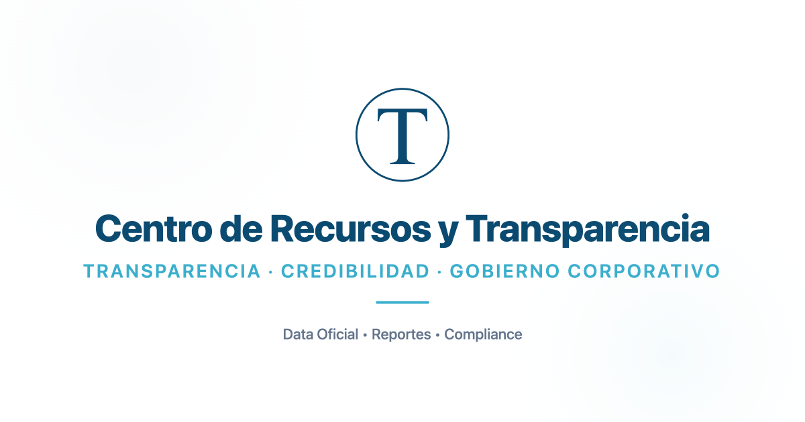

## Datos Clave y Casos de Impacto Global

El **acceso a la información pública y corporativa** se consolida como un pilar estratégico de la sustentabilidad, equiparable a la acción climática según la **Meta 16.10 de los Objetivos de Desarrollo Sostenible (ODS)** de la ONU. La transparencia no es un concepto puramente reputacional, sino una herramienta de **gestión de riesgos**, prevención del fraude y supervivencia democrática que opera en tres niveles:

1. **Gobiernos:** Permite a la ciudadanía auditar obras y servicios públicos, corrigiendo fallas institucionales graves.

3. **Empresas:** Facilita el acceso a capital y licitaciones mediante reportes estandarizados y verificables, combatiendo el _greenwashing_.

5. **Ciudadanos y Consumidores:** Transforma el consumo y la participación cívica en decisiones basadas en datos reales y no en promesas de marketing.

| **Entidad / País** | **Hecho o Cifra Verificable** | **Impacto Concreto** |
| --- | --- | --- |
| **Brasil (ONU)** | Solicitud ciudadana expuso el uso de aviones de transporte de órganos por funcionarios. | Reforma del protocolo que ayudó a salvar cerca de **500 vidas**. |
| **India** | Ciudadanos verificaron la falta de fondos reales asignados a un proyecto de agua rural. | Presión social obligó a la finalización de la obra de agua potable. |
| **Tailandia** | Revisión exigida por una madre en un examen de admisión escolar. | Destape de un sistema masivo de fraude en admisiones. |
| **Panorama Global** | **139 países** (90% de la población mundial) tienen leyes de acceso a la información; **6,4 millones** de solicitudes en 2024. | Brecha de implementación: **43%** de los países no registra cuántas solicitudes rechaza. |

![Esta infografía destaca la importancia de la información disponible y transparente para estilos de vida sostenibles. Presenta una combinación de colores verde oscuro y amarillo con estadísticas clave resaltadas en números y bloques de texto en negrita. El contenido muestra que 139 países tienen leyes de acceso público, el 90% de la población mundial supuestamente está cubierta por estos derechos, y se han realizado 6,4 millones de solicitudes de información desde 2024, mientras que el 43% de estas no registran sus propios rechazos.](images/ESTILO-DE-VIDA-SUSTENTABLE.png "Estadísticas sobre acceso y transparencia de información pública")

* * *

## El hábito sustentable que no está en ninguna lista

Cuando pensamos en un estilo de vida sustentable, imaginamos composteras, transporte eléctrico o ropa de segunda mano. Rara vez pensamos en algo tan simple como **preguntar y exigir respuestas verificables** a una empresa, un municipio o un servicio público. Sin embargo, la evidencia internacional dice que este hábito silencioso puede cambiar vidas enteras.

### Tres ejemplos documentados por Naciones Unidas lo muestran bien:

- **En Brasil**, una solicitud ciudadana de acceso a la información destapó que órganos para trasplantes se perdían mientras aviones oficiales trasladaban funcionarios. El caso, una vez expuesto, llevó a cambios que —según cifras citadas por la ONU— ayudaron a salvar cerca de 500 vidas.

- **En una zona rural de India**, vecinos usaron su ley de acceso a la información para comprobar que un proyecto de agua potable no tenía los fondos que decían tener asignados. La presión ciudadana, con papeles en mano, obligó a terminar la obra.

- **En Tailandia**, una madre exigió revisar un examen de admisión escolar amparada en la misma ley. La revisión destapó un sistema de admisión fraudulento y abrió camino a otros estudiantes.

Ninguno de estos cambios partió de una gran ONG ni de un gobierno. Partió de personas comunes que decidieron **no conformarse con la versión oficial** y pedir la información real. Como resume Tawfik Jelassi, alto funcionario de la UNESCO, "la transparencia no es un lujo para las democracias: es una estrategia de supervivencia".

## Los números que casi nadie conoce

Puede que no lo sepas, pero probablemente ya tienes este derecho, aunque nunca lo hayas usado:

- **139 países** —incluido Chile— tienen hoy una ley que garantiza el acceso a la información pública. Eso cubre al **90% de la población mundial**.

- Solo en **2024**, se hicieron **6,4 millones de solicitudes de información** a nivel global. Es decir, millones de personas ya están usando este hábito.

- Pero hay una brecha importante: solo el **55% de la población africana** y el **15%** de quienes viven en Oriente Medio y el Norte de África cuentan con esta protección real.

- Y un dato incómodo: **43% de los países** que tienen esta ley **ni siquiera registran** cuántas solicitudes rechazan. Es decir, ni ellos mismos saben si están cumpliendo su propia norma.

Este derecho no es un capricho occidental: está incorporado en la meta 16.10 de los Objetivos de Desarrollo Sostenible de la ONU, al mismo nivel que otras metas que sí solemos asociar con sustentabilidad, como la acción climática o el consumo responsable.

## No solo se le exige al Estado: las empresas también están cambiando

La transparencia dejó de ser solo un tema de gobiernos. En Chile, la **Cámara de Comercio de Santiago (CCS)**, que agrupa a más de 2.300 empresas, adoptó la transparencia como uno de sus pilares y hoy publica de forma voluntaria una Memoria Integrada Anual bajo los lineamientos de la Norma de Carácter General (NCG) 461 de la CMF (2021), además de medir su huella de carbono desde 2019 a través de HuellaChile, la plataforma oficial del Ministerio del Medio Ambiente.

Esto importa para tu vida diaria: si compras a una marca o contratas un servicio, hoy **puedes** —y cada vez con más frecuencia podrás— pedir esos mismos reportes. Preguntar "¿tienen memoria de sostenibilidad?" o "¿miden su huella de carbono?" es tan válido como preguntar por el origen de un producto.

## El verdadero valor de la información: mejores decisiones para todos

Detrás de cada dato bien documentado hay algo más grande que una cifra: una decisión mejor tomada. Y eso se puede ver en tres niveles distintos.

**Para los gobiernos y las instituciones**, la información transparente es lo que permite corregir errores antes de que se vuelvan tragedias. Los casos de Brasil, India y Tailandia no son solo denuncias exitosas: son decisiones de política pública —reformar un protocolo hospitalario, terminar una obra de agua, cambiar un sistema de admisión— que solo fueron posibles porque alguien pudo _verificar_ la información, en vez de tener que confiar a ciegas en la versión oficial. Sin acceso a datos reales, esas correcciones simplemente no habrían ocurrido.

**Para las empresas**, contar con información propia, verificable y bien reportada dejó de ser un gesto de imagen y se convirtió en una herramienta de gestión de riesgo y de acceso a capital. En Chile, la Comisión para el Mercado Financiero (CMF) exige a las sociedades anónimas abiertas reportar bajo la Norma de Carácter General 461 —y organizaciones como la Cámara de Comercio de Santiago ya reportan de forma voluntaria bajo ese estándar—. Esto no es solo cumplimiento: es la base con la que inversionistas, bancos y socios comerciales _deciden_ con quién trabajar. Una empresa que no puede mostrar datos verificables sobre su desempeño ambiental o social pierde, cada vez más, la opción de participar en licitaciones, acceder a financiamiento verde o cerrar contratos con clientes que sí exigen esa trazabilidad.

**Para ti como usuario o ciudadano**, la información transparente es lo único que convierte una decisión de consumo en una decisión informada. Elegir un producto, un banco, una universidad o incluso un candidato sin datos verificables no es "confiar": es decidir a ciegas. La misma lógica aplica a la ciudadanía frente al Estado: la meta 16.10 de los ODS vincula directamente el acceso a la información con la capacidad de las personas de participar en decisiones que las afectan, no solo de recibirlas.

En los tres niveles se repite el mismo principio: **la calidad de una decisión nunca puede ser mejor que la calidad de la información en la que se basa.** Por eso la transparencia no compite con la sustentabilidad ambiental o social — es la condición que permite que ambas se puedan verificar, en vez de solo prometerse.

## La conclusión que nos deja esta evidencia

No hace falta ser periodista de investigación ni activista de tiempo completo para practicar este hábito. Basta con **dejar de aceptar respuestas vagas** y empezar a pedir la información real detrás de las decisiones que afectan tu agua, tu salud, tu educación o tu consumo. Como muestran los casos de Brasil, India y Tailandia, a veces esa simple pregunta es lo que cambia comunidades enteras.

* * *

## Guía ciudadana: Cómo llevar la exigencia de transparencia a tu rutina diaria

Al igual que aprendiste a separar la basura para reciclar o a leer las etiquetas nutricionales, exigir información verificable se puede transformar en un hábito cotidiano. Para tomar decisiones realmente informadas y frenar tanto la desinformación como el _greenwashing_, aplica estos cinco pasos prácticos en tu día a día:

1. **Prioriza los datos por sobre las promesas:** Antes de comprar un producto o contratar un servicio, exige métricas concretas. Desconfía de adjetivos genéricos como "100% ecológico" o "sustentable" que carezcan de cifras de respaldo; la ausencia de evidencia es la señal de alerta más común del _greenwashing_.

3. **Audita los reportes corporativos:** Investiga si la empresa publica una Memoria de Sostenibilidad o si cuenta con mediciones oficiales en plataformas como **HuellaChile** (del Ministerio del Medio Ambiente) o bajo el estándar de la CMF (**NCG 461**). Si esta información no está pública en su web, solicítala directamente por sus canales oficiales de atención al cliente.

5. **Ejerce tu derecho cívico con la Ley 20.285:** Recuerda que pedir explicaciones al Estado no es un favor, es un derecho garantizado. Utiliza el Portal de Transparencia en Chile para solicitar a los organismos públicos contratos, presupuestos o datos sobre proyectos que impacten a tu entorno; las autoridades están legalmente obligadas a darte una respuesta fundamentada.

7. **Rastrea el origen de cada cifra:** Desconfía de las estadísticas sin atribución o con referencias vagas. Acostúmbrate a verificar que los datos provengan de una fuente primaria y validada (como ministerios, organismos reguladores, la ONU o universidades).

9. **Comparte lo que aprendes:** La rendición de cuentas genera un efecto multiplicador. Cuando compartes reportes reales o enseñas a otros a pedir información, ayudas a que más personas ejerzan este derecho y presionas a las organizaciones a elevar sus estándares sociales y ambientales.

* * *

## Preguntas Frecuentes sobre Transparencia y Sustentabilidad

### ¿Cuál es el hábito sustentable menos conocido?

El hábito sustentable menos evidente es **exigir información pública y corporativa verificable**. Solicitar datos concretos a empresas y organismos del Estado permite auditar compromisos, prevenir prácticas ilegales, evitar el _greenwashing_ y tomar decisiones de consumo realmente informadas.

### ¿Qué relación existe entre la transparencia y la sustentabilidad?

La transparencia es la condición esencial que permite verificar que las acciones sustentables sean reales. Está respaldada por la **Meta 16.10 de los ODS de la ONU**, la cual consagra el acceso a la información como un derecho fundamental para el desarrollo sostenible, al mismo nivel de importancia que la acción climática.

### ¿Cómo se regula y solicita la información pública y corporativa en Chile?

En Chile operan dos normativas clave:

- **Sector Público:** La **Ley 20.285 (Ley de Transparencia)** permite a cualquier persona solicitar información a organismos del Estado, los cuales están obligados a entregar respuestas fundamentadas.

- **Sector Privado:** La **Norma de Carácter General (NCG) 461 de la CMF** exige a las grandes empresas reportar métricas de sostenibilidad (ASG/ESG) en sus memorias anuales, práctica que también adoptan voluntariamente gremios como la Cámara de Comercio de Santiago.

### ¿Qué puedo hacer si una marca dice ser "sustentable" sin mostrar datos?

Debes exigir directamente sus reportes o cifras verificables a través de sus canales oficiales. La ausencia de datos concretos y el uso de adjetivos genéricos sin respaldo métrico es una señal clásica de **greenwashing** (lavado de imagen verde).

### ¿Por qué la información transparente mejora la toma de decisiones?

Porque la calidad de cualquier decisión —de un gobierno, una empresa o un ciudadano— depende exclusivamente de la precisión de los datos en los que se basa. Sin información verificable, las instituciones no pueden corregir fallas a tiempo y las personas terminan decidiendo "a ciegas" basándose solo en promesas.

* * *

## **Fuentes citadas:**

- UNESCO / ONU Derechos Humanos, _"La transparencia y el acceso a la información pública en América Latina y el Caribe: pilares de la democracia"_ (2024).

- Naciones Unidas, Crónica ONU, _"Acceso a la información: piedra angular del desarrollo sostenible, los derechos humanos y la resiliencia ambiental"_, por Tawfik Jelassi (2025).

- Cámara de Comercio de Santiago (CCS), _"Sostenibilidad CCS"_ y Memoria Integrada Anual.

* * *

**El verdadero cambio empieza cuando dejas de asumir y empiezas a verificar.** No te quedes solo con nuestra palabra: pon en práctica este hábito hoy mismo. Explora los estudios globales, las normativas y todas las cifras de este reportaje directamente en el [**Centro de Recursos y Transparencia de Tiempos Sustentables**.](https://tiempossustentables.cl/centro-de-recursos/)

 

