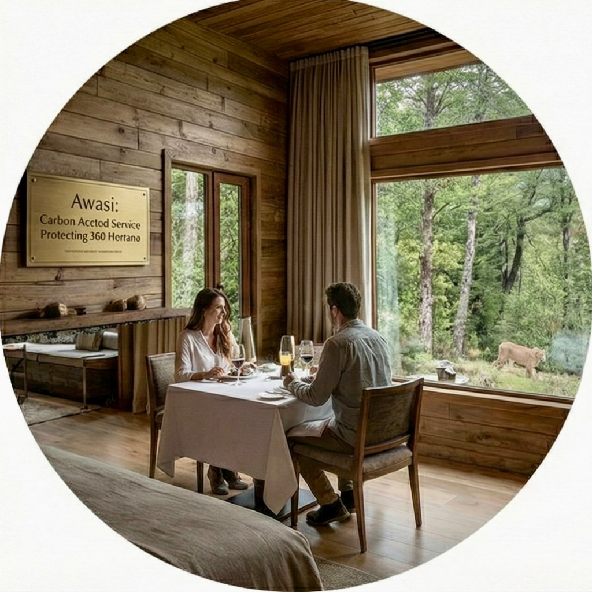
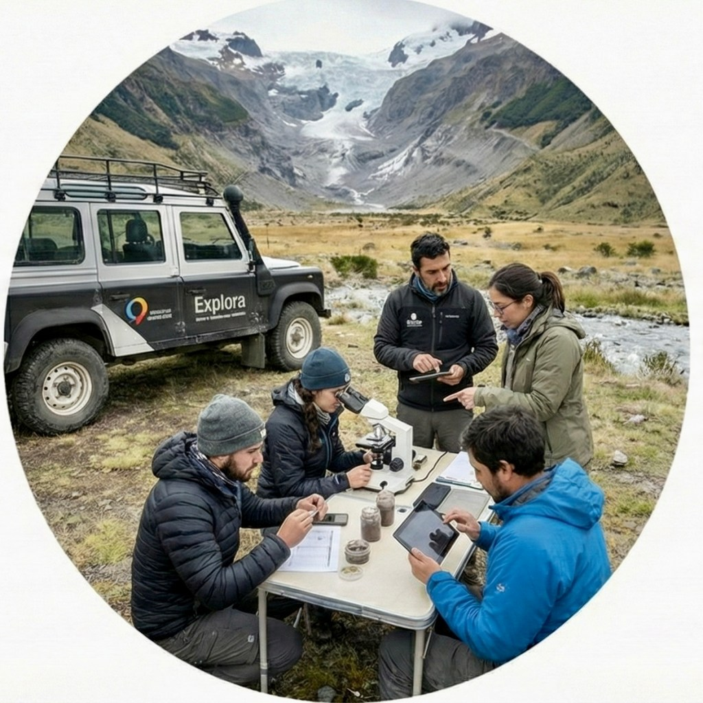
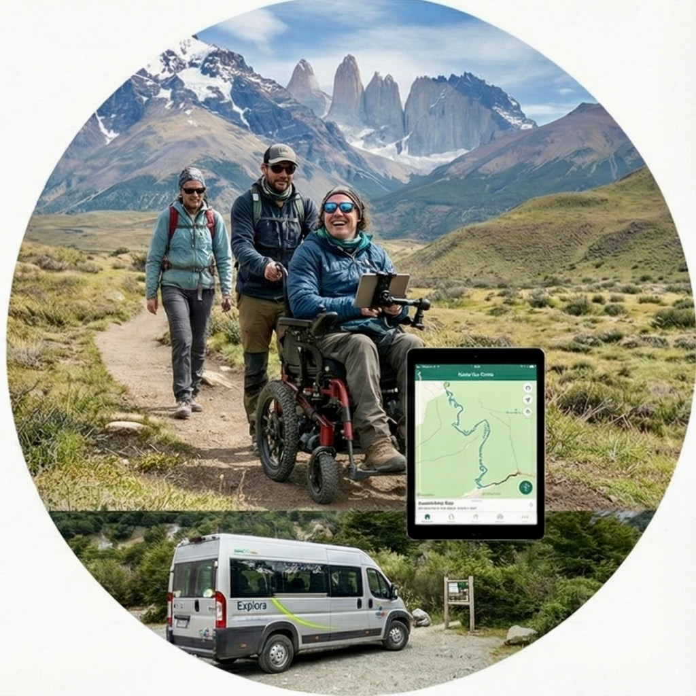

```
Hacia 2025, la "licencia social" ha dejado de ser una metáfora. En Chile, la viabilidad de una inversión turística ya no depende de su campaña de marketing, sino de su capacidad auditada para regenerar el ecosistema que explota.- El Dato: El 65% de los turistas de largo radio eligen Chile exclusivamente por su naturaleza; destruir el paisaje es destruir el activo.- El Riesgo: El "lavado verde" ya no es solo un problema de imagen, conlleva demandas millonarias y paralización de proyectos.- La Oportunidad: La tecnología (IoT y Blockchain) y la gobernanza con comunidades indígenas son las nuevas ventajas competitivas.
```


## El Fin de la Inocencia: Del Volumen al Valor

No nos engañemos. Durante décadas, la industria turística latinoamericana operó bajo una premisa extractivista: el paisaje era un _commodity_ infinito y gratuito. Esa era ha terminado abruptamente.

En la actualidad, la sostenibilidad ha experimentado una evolución significativa y se ha convertido en un elemento indispensable en la gestión de activos. Ante los nuevos estándares financieros, evaluar el éxito a partir de "llegadas de turistas" se considera una vulnerabilidad operativa. El nuevo indicador clave de rendimiento (KPI) es la **Resiliencia Ecosistémica**.

En un Chile donde el **65% de la demanda de largo radio** (EE.UU., Europa) compra exclusivamente "naturaleza prístina", la degradación ambiental no es un problema ético. Es una amenaza directa al flujo de caja. Si el glaciar retrocede o el humedal se seca, el activo subyacente vale cero.

## Market Pulse: La Fuga de Capitales hacia lo "Regenerativo"

El dinero es cobarde y está huyendo de los modelos tradicionales. Mientras la hotelería masiva enfrenta saturación y márgenes decrecientes, los capitales inteligentes están migrando hacia activos que garanticen seguridad climática.

La brecha de crecimiento es brutal y dibuja dos velocidades en la región:

- **Turismo Convencional (Business as Usual):** Crecimiento inercial del **6.67%**. Activos expuestos a riesgo climático y regulatorio.

- **Turismo Regenerativo/Sostenible:** Expansión agresiva del **19.0%** (CAGR).

- **Proyección LATAM 2033:** El mercado saltará de US$186 mil millones a US$583 mil millones.

**¿La lectura para el inversor?** Apostar hoy por infraestructura turística que no regenere agua o suelo es comprar un activo varado (_stranded asset_) antes de inaugurarlo.

## El "Cuello de Botella" Institucional: La Crisis del SBAP

Chile tiene el potencial, pero también el freno de mano puesto. El **Servicio de Biodiversidad y Áreas Protegidas (SBAP)**, diseñado para ser el "guardián" del patrimonio natural, vive una parálisis técnica que cuesta millones en Inversión Extranjera Directa (IED).

La situación es crítica: la falta de **Planes de Manejo** operativos (Art. 58-62) impide entregar concesiones turísticas a largo plazo con certeza jurídica. Mientras Costa Rica y Colombia ofrecen incentivos fiscales vinculados a certificaciones verdes, Chile mantiene atrapada su gestión de parques en una pugna de lobby industrial. Minería y salmonicultura ven la protección oficial como una amenaza a sus concesiones, generando un **bloqueo legislativo** que ahuyenta al capital serio y favorece la informalidad.

## Los Nuevos Dueños del Tablero: Arquetipos de Éxito

Quienes están ganando la partida no son los que tienen más habitaciones, sino los que tienen más _ciencia_.



**El Guardián (Awasi):** Han entendido que el lujo es la privacidad y el aire puro. Al proteger 340 hectáreas de bosque nativo, logran una neutralidad de carbono _matemática_, no comprada en bonos de dudosa procedencia.



**El Científico (Explora):** Su transformación es radical. Ya no son hoteleros; son una plataforma de exploración científica financiada por viajeros. El viaje subvenciona el conocimiento biológico necesario para la conservación.



**El Disruptor (Wheel the World):** Desafiaron la lógica del mercado al digitalizar la accesibilidad. Han demostrado que la inclusión no es caridad, es un mercado desatendido de mil millones de usuarios y una fuente masiva de rentabilidad.

## Zona Roja: Greenwashing y el Riesgo de Litigio

Atención a los departamentos legales: el "maquillaje verde" ha pasado de ser un riesgo reputacional a un **riesgo judicial**.

El caso de la industria salmonera en el sur de Chile es paradigmático. Financiar museos o pintar escuelas ya no sirve para tapar la eutrofización de los fiordos. La sociedad civil y los inversores internacionales están utilizando tecnología satelital y _blockchain_ para auditar impactos reales.

```
La judicialización se está extremando. Vemos desde demandas millonarias contra activistas (SLAPP) hasta comunidades indígenas, como los Lickanantay en Atacama, ejerciendo vetos efectivos bajo el Convenio 169 de la OIT. El mensaje es claro: sin licencia social, no hay proyecto viable.
```

## Escenarios Prospectivos (2026-2035)

Basado en el análisis de las tensiones regulatorias actuales y las tendencias de mercado, el futuro del sector en Chile no está predeterminado; se construye con las decisiones de inversión de hoy. La siguiente infografía proyecta tres **escenarios prospectivos para la década 2026-2035**, visualizando la correlación directa entre la gestión del capital natural y los retornos financieros. Se ilustra una encrucijada crítica: enfrentar la destrucción de activos bajo un modelo extractivista, atrincherarse en nichos de lujo excluyente, o desbloquear un crecimiento sostenido y de alto impacto a través de la **Integración Regenerativa**, el único camino que combina rentabilidad masiva con seguridad climática y social.

![Infografía de Tiempos Sustentables titulada 'Escenarios Prospectivos (2026 - 2035)'. Compara tres futuros para la inversión turística en Chile mediante columnas con indicadores de Probabilidad, Impacto ($) y Resultado. La Columna A, verde, 'La Fortaleza Verde', muestra una mansión y un jet, indicando turismo de ultra-lujo excluyente con probabilidad media e impacto de nicho. La Columna B, roja, 'Las Venas Abiertas', muestra un paisaje industrial contaminado, señalando el triunfo del lobby extractivo, colapso hídrico y un impacto financiero negativo con riesgo de destrucción del activo. La Columna C, azul, 'Integración Regenerativa', es la más deseable con probabilidad alta e impacto económico muy alto; ilustra una comunidad con tecnología (IoT/Blockchain) y energías renovables, resultando en gobernanza mixta y un crecimiento sostenido del 19%.](images/escenarios-prospectivos-2026-2035.png)

## Roadmap: ¿Qué debe hacer Chile ahora?

Para que la **Estrategia Turística 2035** no sea papel mojado, se requieren acciones quirúrgicas:

1. **Desbloqueo Político:** Separar urgentemente la gestión de áreas protegidas de las presiones industriales. El SBAP debe operar con autonomía técnica.

3. **Auditoría Radical:** El sector privado debe adoptar estándares tipo _Verra_ o _Gold Standard_. El auto-reporte ya no tiene validez ante la banca internacional.

5. **Tecnología Hídrica:** Invertir en IoT para monitoreo de cuencas es más rentable que construir nuevas habitaciones. Sin seguridad hídrica, no hay hospitalidad.

## Conclusión Editorial

La historia económica del turismo en Latinoamérica está a punto de reescribirse, y las viejas métricas de éxito han caducado.

La próxima década no pertenecerá a quien construya el hotel más grande, sino a quien logre **demostrar** —con datos, ciencia y transparencia— que su operación deja el lugar mejor de lo que lo encontró. En un mercado donde el riesgo ambiental es riesgo financiero, el **Turismo Regenerativo** ha dejado de ser una aspiración ética para convertirse en la única **póliza de seguro válida contra la obsolescencia climática**.

Para el inversor, la ecuación es simple: o se regenera el activo natural, o se pierde el capital. El futuro del turismo en Chile será regenerativo, o no será.

* * *

### **Radiografía Visual**: **Por qué el Capital Inteligente Huye hacia el Turismo Regenerativo en Chile**

La transición del sector turístico chileno ya no es una opción ideológica, sino una urgencia financiera. Los datos son contundentes: el modelo tradicional, basado en la explotación pasiva del paisaje, enfrenta una obsolescencia acelerada marcada por riesgos climáticos, parálisis regulatoria y una creciente judicialización.

Frente a esto, el **Turismo Regenerativo** emerge no solo como la alternativa ética, sino como la única estrategia de inversión resiliente y rentable para la próxima década en Chile.


* * *
