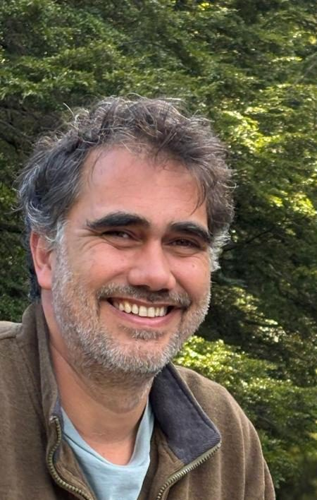

El Turismo Regenerativo es mucho más que una forma de viajar: es un enfoque que desarrolla capacidades para crear experiencias de conexión profunda y valor entre las personas, la cultura y la naturaleza. No se trata solo de visitar lugares, sino de participar activamente en la regeneración de los sistemas naturales y culturales que sostienen la vida. Este modelo propone una economía próspera que surge desde el lugar y para el lugar, fortaleciendo comunidades y ecosistemas de manera conjunta.

Chile, con su inmensa diversidad natural y cultural, enfrenta una encrucijada urgente: seguir apostando por un turismo masivo que degrada paisajes y comunidades, o avanzar hacia un modelo regenerativo que no solo minimice el impacto, sino que contribuya activamente a restaurar el entorno y promover el bienestar de las comunidades locales y visitantes.

Esta perspectiva transformadora es especialmente relevante en territorios frágiles como la Patagonia, Rapa Nui o los humedales del norte, donde el turismo regenerativo puede ser una herramienta clave para el desarrollo equilibrado. Para lograrlo, es fundamental trabajar de la mano con las comunidades, respetar los saberes ancestrales y promover experiencias que conectan profundamente a las personas con la naturaleza, más allá de la simple observación.

Sin embargo, implementar este enfoque implica enfrentar desafíos significativos. Se requieren cambios estructurales en la planificación turística, capacitación especializada, incentivos públicos adecuados y, especialmente, voluntad política. El visitante también debe asumir un rol activo y comprometido, entendiendo que el turismo regenerativo exige respeto y responsabilidad hacia el territorio que se visita.

Hoy más que nunca, necesitamos un turismo que regenere y que deje los lugares mejor de lo que los encontró. Chile cuenta con todas las condiciones para liderar esta transición en América Latina, pero el camino exige decisiones valientes y colaboración genuina entre el Estado, las comunidades y el sector privado.

Cuidar el turismo es cuidar el futuro de Chile.

**Martín Araneda  
**Cofundador Camina Consultores
