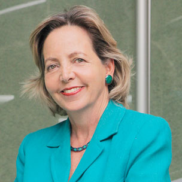

El reciente Foro de CEPAL, donde participó Pacto Global, relevó un desafío crítico: efectivamente ningún país, de los que conforman la ONU, está en condiciones de cumplir los ODS para 2030 y aunque es algo que sabemos, desde Pacto Global, vivimos el sentido de urgencia. 

Esta evidencia no es sorprendente, dada la magnitud de los retos globales, y el desalentador panorama mundial. Las metas planteadas por la Agenda 2020 son ambiciosas, e implican desafíos mayores, como reducir la desigualdad, abordar el cambio climático de manera decidida y consensuada, disminuir la pobreza, y todas requieren esfuerzos adicionales a los que cada país tiene programado, y requiere hacerlo de manera coordinada y sostenida en el tiempo. 

En el caso de Chile y América Latina, los avances han sido disímiles. Por ejemplo, Chile ha mostrado un cierto progreso en áreas como la reducción de la pobreza y algunos aspectos en el acceso a la educación, pero enfrenta desafíos significativos prácticamente en todos los ODS.

Dado el retraso, Pacto Global ha lanzado a nivel mundial, el programa Forward Faster ( Avanzar más rápido), iniciativa que busca precisamente que las empresas contribuyan más decididamente a acelerar el progreso, focalizándose en cinco áreas identificadas clave, para procurar alcanzar las metas que plantean los Objetivos de Desarrollo Sostenible (ODS): Igualdad de género, acción climática, salario digno, agua y finanzas e inversiones sostenibles. Este llamado a la acción es especialmente relevante para América Latina, donde las brechas son estructurales.

Todos coincidimos en que el progreso hacia los ODS es insuficiente y disperso. Sin embargo, un hallazgo que puede considerarse alarmante es la magnitud de los retrocesos en áreas como la sostenibilidad ambiental y la igualdad de género, incluso en países con economías avanzadas. 

Estos resultados refuerzan la percepción de que los desafíos estructurales, como la guerra y las tensiones geopolíticas, la pobreza y los efectos del cambio climático, requieren un enfoque absolutamente colaborativo en función de la magnitud de los desafíos que enfrentamos y la urgencia de actuar mancomunadamente para buscar soluciones integrales.

Sin duda, no se puede dejar de considerar el tremendo impacto de la pandemia, que desató una crisis sanitaria, económica y social sin precedentes. Y ese momento marcó un ralentizamiento del progreso global, afectando especialmente a los países y sectores más vulnerables. Factores como la pobreza, la desigualdad de género y la falta de acceso a recursos básicos, siguen siendo barreras significativas, especialmente en regiones con menor desarrollo económico. Hoy, las guerras y las tensiones geopolíticas, así como las alteraciones de los mercados,  están desviando recursos y atención, en los esfuerzos que venían realizándose en materia de desarrollo sostenible.

Aunque aún es posible lograr avances significativos, sin duda es poco realista pensar que todos los países cumplirán completamente con las metas en el plazo original. Estamos ciertos que revisarlas y extender los tiempos podría ser una opción, pero debe hacerse con precaución para no diluir el sentido de urgencia que los ODS buscan transmitir. 

Lo más importante es priorizar las acciones transformadoras en áreas clave y fortalecer la colaboración global y local para avanzar lo máximo posible hacia los objetivos, incluso si no se logran plenamente dentro del plazo. 

En este contexto, la meta del 2030 debe ser vista como un objetivo motivador, aunque cuando estemos más cerca, será necesario realizar ajustes para adaptarse a realidades específicas.

Sin avances significativos, las brechas entre países desarrollados y en desarrollo, se ampliarán, perpetuando ciclos de pobreza y exclusión social. La falta de acción climática y la postergación de la sostenibilidad, podría llevar a un punto crítico irreversible, con efectos devastadores para ecosistemas y comunidades.

Los desequilibrios persistentes dificultarían el crecimiento económico global, afectando los mercados y el comercio en general, las inversiones y el bienestar de las personas. Sin lugar a dudas, los problemas relacionados con la escasez de recursos, las migraciones forzadas y las tensiones geopolíticas, podrían intensificarse.

De hecho, la incapacidad de cumplir con los ODS reflejaría un déficit en la gobernanza, afectando la confianza en las instituciones y la cooperación internacional. Esta incapacidad de alcanzar estas metas, o acercarse a ellas, subrayaría la urgencia de implementar estrategias más ambiciosas y coordinadas. 

En todo caso, llegar al 2030 y evidenciar su no cumplimiento, no debería tomarse como un fracaso sin esperanzas, sino que un nuevo impulso para seguir en esa dirección, con lecciones aprendidas.

**Margarita Ducci**

Directora Ejecutiva

Red Pacto Global Chile (ONU)

* * *

 

